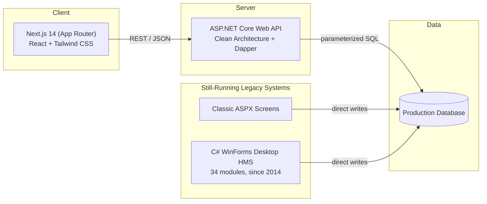

# 🏥 NHFRI HIMS
### Hospital Information Management System — Legacy-to-Web Migration

A full-stack case study from my work building and migrating a hospital's
operations software — from a 34-module desktop system I've co-developed since 2014,
to a modern web application.

---

## 📋 Table of Contents

- [Background](#-background)
- [Web Migration — Overview](#-web-migration--overview)
- [System Architecture](#-system-architecture)
- [My Role](#-my-role)
- [Tech Stack](#-tech-stack)
- [Impact at a Glance](#-impact-at-a-glance)
- [Modules Delivered](#-modules-delivered)
- [Security & Reliability Highlights](#-security--reliability-highlights)
- [Note on Scope](#-note-on-scope)
- [Let's Connect](#-lets-connect)

---

## 🏢 Background

Since **2014**, I've been one of the core developers on this hospital's in-house
**desktop Hospital Management System** (C# WinForms, Visual Studio, SQL Server) — a
**34-module** solution still running in production across **two hospital branches**
today. I've personally built and maintained the majority of these modules,
including:

| Area | Modules |
|---|---|
| **Accounts & Billing** | Cash Counter, General Accounts, Office Accounts, Billing, Hospital Statement, Financial Assistance Fund |
| **Patient Management** | In-Patient, Out-Patient, Record Room, Consultant Chamber |
| **Diagnostics** | Cath Lab, Echocardiography, ETT, Pathology, Radiology, Cardiac Wellness Center |
| **Inventory & Pharmacy** | General Store, Medical Store, Pharmacy |
| **HR & Admin** | HRM, Payroll, Security, Security Officer, IT, Audit, Library |
| **Other** | Surgery, HTN (Hypertension Program), Freedom Fighters' Welfare, Service & Maintenance, Utility |

Alongside this, I independently built and maintain a separate **Pharmacy POS**
system and a **Canteen Management** system for the hospital (also VS/SQL Server
based).

This repository documents the **next chapter**: migrating that decade of
hospital-domain knowledge into a modern web stack — while the legacy systems above
stay live and keep writing to the same production database throughout the
migration.

## 🧭 Web Migration — Overview

**National Heart Foundation Hospital & Research Institute (NHFH&RI)** is migrating
its day-to-day hospital operations software to a modern web application — Next.js
on the frontend, ASP.NET Core on the backend — rebuilding each module with real
production data, real concurrent users, and zero tolerance for downtime.

## 🏗️ System Architecture

Both the new web stack and the legacy systems (desktop HMS + classic ASPX
screens) write directly to the **same production relational database** — every new
feature has to coexist safely with writers it doesn't control, which shapes
most of the concurrency patterns throughout this project.

## 👨‍💻 My Role

**Full-stack developer**, owning features end-to-end:

- Additive schema changes on a **live production database**, never breaking the legacy
  systems (desktop HMS, classic ASPX apps) still running against it
- REST APIs following Clean Architecture (Domain / Application / Infrastructure)
- The corresponding Next.js / React interface, built for non-technical hospital
  staff and the public
- Independent security reviews of features before they go live

## 🛠️ Tech Stack

| Layer | Technology |
|---|---|
| **Frontend** | Next.js 14 (App Router), React, Tailwind CSS |
| **Backend** | ASP.NET Core Web API, Clean Architecture, Dapper |
| **Database** | Oracle |
| **Legacy stack (since 2014)** | C# WinForms, Classic ASP.NET, SQL Server |
| **Patterns** | Repository + Unit of Work, lock-and-retry for tables shared with legacy systems |

## 📊 Impact at a Glance

| | |
|---|---|
| 🏥 **10+ years** | building this hospital's software, 2014–present |
| 🧩 **34-module system** | the majority personally built, in the legacy desktop HMS across 2 branches |
| 🎫 **Tens of thousands** | of live complaint records handled by the rebuilt helpdesk |
| 📢 **Thousands** | of live notices migrated to the new public-facing system |

## 🚀 Modules Delivered

### 📢 Notice & Communication System

<b>Public notice board, view-tracking, full audit history</b>

- Public, no-login notice board (`/notices`) replacing a login-only legacy screen —
  search, date filters, "new" badges tracked per visitor, attachment preview.
- **View-tracking** ("who's seen this") for both staff and public visitors, joined
  against existing device/employee records rather than adding new tracking
  infrastructure.
- **Edit / Close / Reopen with full audit trail** — a new audit table records every
  change (who, when, what the text used to say), restricted to the original author
  or an admin.
- Hardened in a dedicated security pass: added missing author-or-admin checks on
  several endpoints that had none, restricted creation to active staff only, fixed a
  race condition in concurrent view-counting.

### 🎫 Complaint / Helpdesk System

<b>Public ticketing, QR verification, print slips, full security review</b>

- Public ticket submission (`/complaints`) with branch + department routing,
  priority levels, and status lookup by ticket number or QR code.
- **Printable complaint slips** reusing the app's existing letterhead print
  pipeline, with an embedded QR code linking straight to the ticket's live status.
- **Found and closed a data-exposure issue**: a public page was fetching the
  full complaint dataset and filtering it client-side, incidentally exposing
  reporters' personal contact details to any visitor. Replaced with
  purpose-built, server-filtered endpoints that never return personal data.
- Diagnosed and fixed several backend bugs causing complaint statuses to read
  incorrectly, and a duplicate-ticket-number bug caused by two different systems
  writing to the same table with incompatible numbering schemes.

### 📅 Appointment & Consultant Suite

<b>Booking, a hospital-wide date switch, and a slot-scheduling tool</b>

- **Book Appointment** — walk-in booking reverse-engineered from a legacy ASPX
  screen, built to stay write-compatible with it (handles concurrent-insert
  collisions on a table both apps write to); enforces a hard, race-condition-safe
  capacity cap against the generated slot schedule, and flags cross-doctor
  duplicate bookings for staff without blocking them.
- **Patient lookup & admission workflow** — mobile/Patient-ID autofill against
  full appointment history (not just the current day), a same-day "Admit
  Request" action server-enforced to apply only to today's entries, and a
  standalone lookup so staff can verify a patient's claimed booking by phone
  number alone.
- **Appointment Date Switch** — a single-row "current booking date" control used
  hospital-wide, redesigned with a complete, append-only audit trail, without
  altering the existing production table.
- **Consultant Time Setup** — mirrors an existing legacy desktop screen: generates
  per-doctor daily appointment slots from a start time, interval, and patient count.
- **Consultant Management** — admin CRUD mapping hospital staff to the "active
  consultants" used across every booking module.
- **SMS notifications** — a reusable, provider-agnostic SMS sending/logging
  service (behind a third-party gateway), triggered on booking confirmation and
  on admission requests; every attempt is logged for traceability, and the
  gateway call is fully isolated so a delivery failure can never turn an
  already-successful booking into a false failure response.

### 🏠 Staff Portal & Dashboard

<b>Public staff portal, performance-first dashboard</b>

- Rebuilt the public homepage from a generic marketing template into a real staff
  portal — live OPD/IPD/CAG/CABG counts, module shortcuts, an announcements board —
  while closing an access-control gap that had exposed data without login.
- Dashboard redesigned for performance: independently-loading cards instead of one
  blocking request, server-side pagination + infinite scroll replacing a widget that
  was pulling a large legacy table just to show the latest 10 entries.

### 🛏️ Live Bed Statement

<b>Public ward/cabin occupancy board, no login required</b>

- Ward/cabin-wise Total/Occupied/Empty bed counts for both hospital branches, read
  live off existing reporting views — a public, no-login page for a quick
  glance, plus a themed version embedded in the authenticated dashboard, both built
  on one shared data-fetching hook instead of duplicating the polling logic.
- Auto-refreshes every 30s without blocking the UI: pauses while the browser tab is
  backgrounded and catches up instantly on refocus; a failed refresh keeps the last
  good data on screen with a stale-data notice, rather than blanking the view.
- Along the way, found and fixed two real backend bugs: a menu-creation endpoint
  that always reported failure due to a database-driver quirk around how it read
  back an insert's result, and a query-ordering bug affecting a multi-branch report.

### 🧩 IT Asset Tracking *(early stage)*

<b>Phase 1 of a planned, department-agnostic asset registry</b>

- Asset registry UI (Add/Edit/Delete, duplicate-ID validation, searchable
  dropdowns) designed so Department/Category/Branch stay dynamic master data —
  built to be reusable by other departments (Biomedical, Facilities), not
  IT-specific.

### ⚙️ Platform Engineering

<b>Menu/permissions system, database driver bugs, branch master data</b>

- Diagnosed and fixed a database parameter-binding bug causing silent data
  corruption across multiple admin screens — shipped a reusable wrapper to
  prevent it recurring.
- Designed a dynamic, database-driven menu + role-permission system so new pages
  can be wired up without a deployment.
- Introduced a proper master-data table for hospital branches, replacing an
  ad-hoc, schema-per-branch convention.

## 🔒 Security & Reliability Highlights

- 🔐 **Found and closed a data-exposure issue** — a public page was exposing
  patients' and staff's personal contact details before login; replaced with
  properly scoped, server-filtered endpoints.
- 🕵️ **Independent security reviews** — ran dedicated review passes (treating my
  own feature work adversarially) that caught authorization gaps, spoofable
  identity checks, and data-exposure risks before each feature's public launch.
- ⚔️ **Concurrency-safe against legacy systems** — tables written to by both the
  new app and still-running legacy systems use table-level locking plus
  retry-on-collision, instead of assuming exclusive ownership; business
  invariants (like a hard appointment-slot capacity cap) are checked inside
  that same locked transaction so they can never be raced past.
- 🔒 **Additive-only database changes** — every schema change on the live
  production database was designed to never alter or drop an existing column or
  table.
- 🔍 **Root-caused, not patched** — silent save failures, misreported insert
  failures, duplicate IDs, and a timezone off-by-one were all traced to their
  actual root cause rather than worked around.
- 🧱 **External-dependency isolation** — the third-party SMS gateway integration
  is wrapped so a delivery failure there can never cascade into a false failure
  on the underlying booking/admission API call.

## 📝 Note on Scope

> This repository is a **written case study** of work delivered across these
> projects — it does not contain the hospital's source code, data, specific
> technology versions, or internal infrastructure details.

## 🤝 Let's Connect

I'm actively building production software across ERP, HIMS, and accounting
systems — happy to talk about this project, a role, or a new build.

- 💼 **LinkedIn**: [linkedin.com/in/azizulhaquesohel](https://www.linkedin.com/in/azizulhaquesohel/)
- 📧 **Email**: [azizulbcse@gmail.com](mailto:azizulbcse@gmail.com)
- 🐙 **GitHub**: [@azizulbcse](https://github.com/azizulbcse)